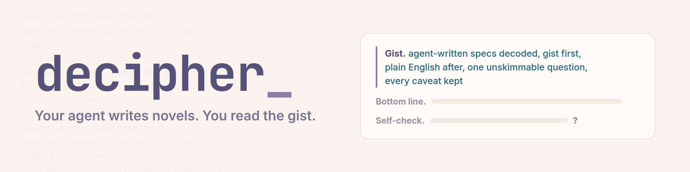
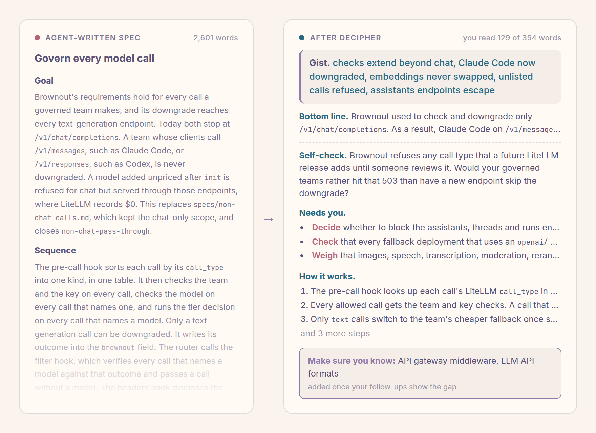

<p align="center">
  <picture>
    <source media="(prefers-color-scheme: dark)" srcset="assets/banner-dark.png">
    
  </picture>
</p>

**Gist.** agent-written specs decoded, gist first, plain English after, one unskimmable question, every caveat kept

**Bottom line.** Your agent writes a 1,600-word spec, and you approve it after a skim. decipher rewrites any agent-written document so its first three parts carry the whole idea in plain English, in about 120 words. The rest waits below as reference, and anything it skips is named.

**Self-check.** You approved your agent's last spec. Could you name its riskiest assumption without opening it?

[](https://github.com/amirimi/decipher/actions/workflows/validate.yml)
[](LICENSE)
[](#install)

<picture>
  <source media="(prefers-color-scheme: dark)" srcset="assets/hero-dark.png">
  
</picture>

## Install

**Claude Code** gets the skill and an always-on output style.

```text
/plugin marketplace add amirimi/claude-plugins
/plugin install decipher@amirimi
```

**Any other agent that reads `SKILL.md`** gets the skill.

```bash
npx skills add amirimi/decipher
```

Tested with Claude Code 2.1.284.

<details>
<summary>Install from a clone for live editing</summary>

```bash
git clone https://github.com/amirimi/decipher ~/decipher
ln -s ~/decipher/skills/decipher ~/.claude/skills/decipher
mkdir -p ~/.claude/output-styles
ln -s ~/decipher/output-styles/decipher.md ~/.claude/output-styles/decipher.md
```

</details>

## Use

Point it at a document, or say "decipher" after a reply that lost you.

```text
/decipher specs/link-previews.md
```

| Say | Get |
|---|---|
| decipher, simplify this | The latest reply or a named document, rewritten |
| decipher, again on the same document | A new angle with none of the earlier sentences |
| walk me through a spec, PR, or report | Three to five parts, one per turn, with a bookmark |
| continue, back, all at once, stop | Moves through the walkthrough |
| I'm lost | The goal again, from a different angle |

Specs and design docs are home turf. PRs, reports, incident write-ups, READMEs, and agent replies work too.

## Every answer, same shape

```text
Gist.          a few words that carry the whole idea
Bottom line.   what it does, where it stands, what backs it
Self-check.    one question you answer to yourself
-------------  most readers stop here
Terms.         only when the jargon would lose you
Needs you.     decisions, blockers, risks
How it works.  the steps, in order
What changes.  who and what feels it
Held back.     everything skipped, by name
```

The Self-check is the point. It comes from the document's own premise and asks for your judgment, so scrolling back won't answer it. Can't answer it? You've stopped steering. Take the wheel back before you approve anything.

## "Can't I just tell Claude to be concise?"

Go ahead. A concision rule shapes the next thing your agent writes. The 1,600-word spec already in your repo stays 1,600 words, and so does the PR a teammate's agent opened. decipher works on what already exists. It defines the jargon from the source, keeps what the document claims apart from what anyone verified, and checks that you still follow.

## Always on

The plugin also ships an output style that puts every reply in plain English. Select it in `~/.claude/settings.json`. A plugin install names it `decipher:Decipher`, and a clone install names it `Decipher`.

```json
{ "outputStyle": "decipher:Decipher" }
```

While decipher's rules apply, its own limits replace brevity budgets from other output styles, `CLAUDE.md`, and `AGENTS.md`. Your accuracy and punctuation rules still win.

## A real run

`/decipher` on a 1,618-word agent-written spec for link previews in LiCode, a code-review practice app. The reply runs 461 words, and the three parts you read first run 123.

<details>
<summary>Full reply</summary>

**Gist.** shared links become cards, server writes preview tags, images prerendered and committed, no answers on cards, text edits need rerender, merged but spec stale

**Bottom line.** When someone pastes a LiCode link into a chat app, it now unfurls into a preview card, and the site has a browser tab icon. PR #18 merged this to main, and commit cb7cfce later re-rendered every image at double density. The spec's upper sections still describe a design the implementation replaced, so its "Changes made during implementation" list is the accurate part.

**Self-check.** The spec draws every image ahead of time because the committed images cover every page that exists. Would you keep that design if cases started arriving without an author in the loop?

**Needs you.**
- Four sections and the third open question still describe work the code replaced or finished, such as `manifest.json` and hand-numbered `-v1` image names.
- Criterion 9 names the Facebook and LinkedIn inspectors and a Slack paste. The PR #18 comment instead records crawler user-agent requests and opengraph.xyz, and those checks ran before cb7cfce renamed every image.
- The site card avoids calling every case real because LiCode's authors wrote the Cancel cleanly track and both investigation cases themselves.
- Home still leads with "Make the call before you know how it ended", which may read as a different product from the card.

**How it works.**
1. A platform's crawler fetches the pasted page without running JavaScript and reads the tags in its `<head>`.
2. The server passes the path to `preview_for`, which picks the case, track or site card.
3. A case card shows the case's question, and a track card shows the track's destination. Every other path, including an unknown one, gets the site card.
4. The server writes that card's tags into `index.html`, with absolute URLs only when `LICODE_PUBLIC_ORIGIN` is set.
5. An author renders every image with a Playwright script and commits the PNGs, because the server has no way to draw images.
6. Each image name carries a hash of its card's text, and a test fails until that image exists.

**What changes.**
- Editing a question, track title or destination breaks the tests until someone reruns the render script and commits the new PNG.
- An edited card gets a new image URL, so platforms skip the copy they cached for up to a week.
- A card shows only what its page shows before an answer, and a test checks every case.
- `/favicon.ico` used to return the page HTML and now returns an icon, and pages now answer `HEAD` requests.

**Held back.** The card table's exact wording, the site card mockup and visual style, HTML escaping, the WhatsApp size limit, the Cloudflare check, and the one-row database read.

</details>

## Feedback

decipher left you lost? That's a bug. [Open an issue](https://github.com/amirimi/decipher/issues/new?template=unclear-reply.yml) with the original text and the reply.

## License

[MIT](LICENSE)
